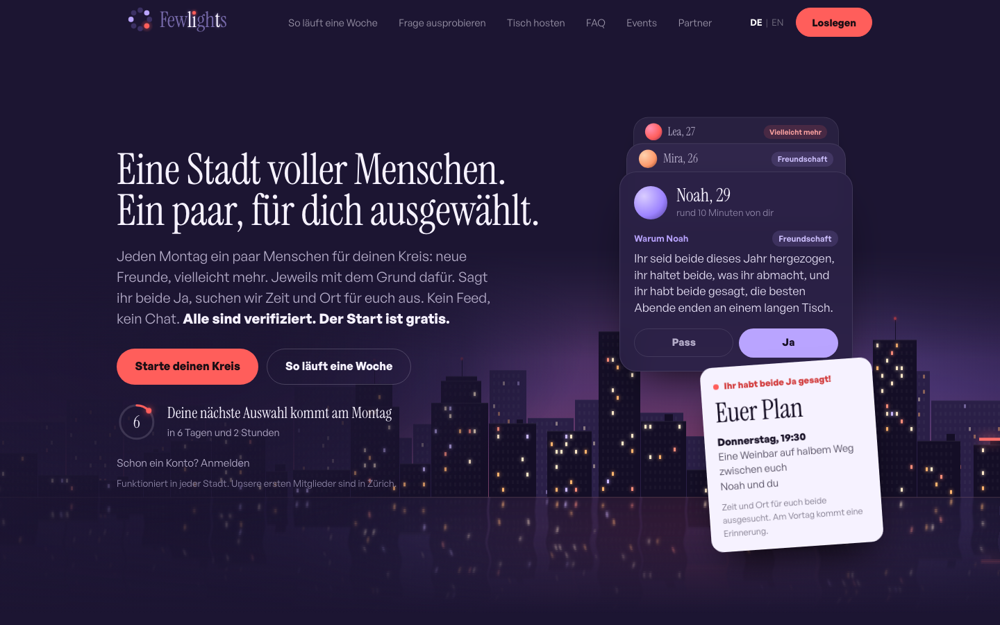
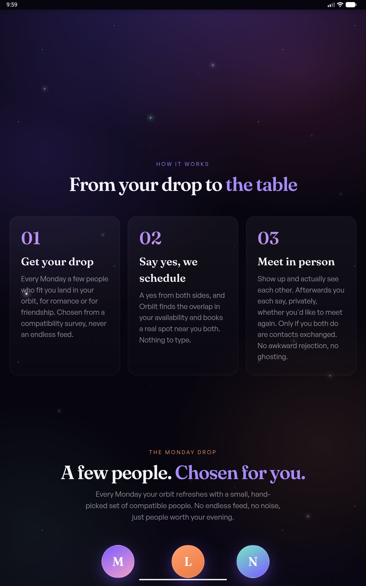
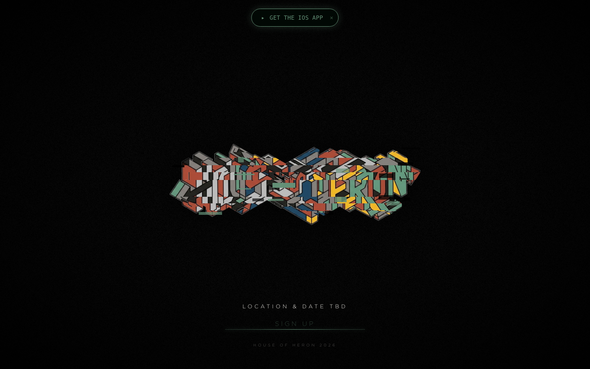
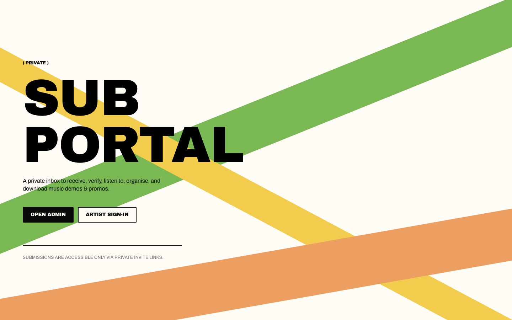
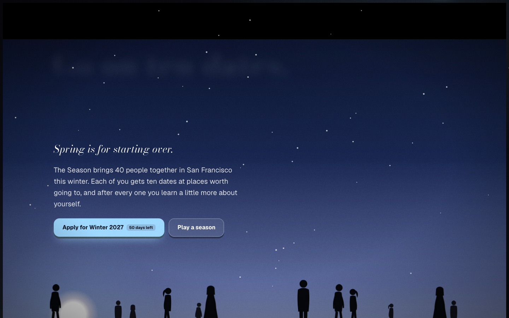
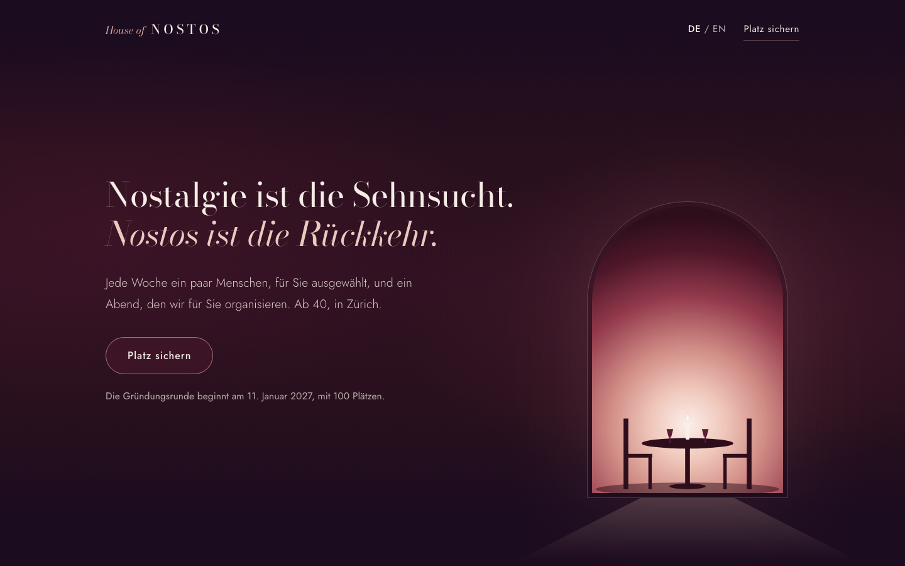

# Shana Stämpfli: things I've built

I'm a computer science master's student at ETH Zürich, currently at the MIT Edelman Lab for my thesis on physics-informed deep learning for intravascular OCT. Alongside the research I build products with real users. The code for these lives in private repositories; this page shows what they are and where to find them live.

CV and contact: [linkedin.com/in/shana-s-61a492123](https://www.linkedin.com/in/shana-s-61a492123) · stampflishana@gmail.com

---

## Fewlights (formerly Orbiit)

**What it is.** A weekly in-person matching app for friendship and romance in Zürich. Every Monday each member gets a few picks with a short reason, says yes or pass, and the app arranges the time and place. 600+ members, 250+ identity-verified, 100 arranged meetups. Live on Google Play since October 2026, iOS in review.

**My part.** Technical co-founder. I own the matching and ranking system, built the AI layer (LLM-written match explanations that are checked against the facts before anyone sees them, and selfie verification with a human decision on rejections), and lead engineering since mid-2026.

**Stack.** React, TypeScript, Vite, Capacitor for iOS and Android, Supabase (Postgres with row-level security, 59 edge functions, scheduled jobs), Vercel.

**Live.** [yourorbiit.com](https://yourorbiit.com)

---

## House of Heron

**What it is.** A vinyl and electronic music community that grew out of a party in Milan and now runs nights in Milan and Amsterdam, with iOS and Android apps. Live on the App Store and Google Play since October 2026.

**My part.** One of five co-founders, and I built the app and everything behind it: passes and door lists with signed QR codes that scan offline (177 check-ins at one night, including on a moving train), Apple and Google Wallet passes, a merch till and cashbook, synced radio and podcast, realtime messaging that is never stored, and four small games used for promotion.

**Stack.** Next.js 16, React 19, TypeScript, Prisma on Supabase Postgres, Capacitor 8, Resend, Upstash, Vercel.

**Live.** [houseofheron.club](https://www.houseofheron.club)

---

## SubPortal

**What it is.** A demo inbox for record labels. Artists send tracks; the label listens, rates and replies in one place instead of a crowded email inbox. Used by two electronic music labels and 80+ artists.

**My part.** Built and run it alone, product to production: multi-tenant portals with per-tenant database access rules, an email-to-invite pipeline, a serverless ffmpeg worker that renders previews and waveforms and estimates BPM and key, resumable 2 GB uploads and streamed ZIP downloads.

**Stack.** Next.js 16, TypeScript, Supabase, GitHub Actions, Postmark, Resend, Vercel.

**Live.** [subportal.art](https://www.subportal.art)

---

## The Season and House of Nostos

Two sister brands on the Fewlights matching engine, each taken from a name to a live application flow in under two weeks in October 2026. The Season is a dating benefit employers buy for their teams, starting in San Francisco. House of Nostos is curated introductions and hosted dinners for people over 40 in Zürich, in German and English.

**Live.** [theseason.world](https://theseason.world) · [houseofnostos.vercel.app](https://houseofnostos.vercel.app)

---

## Match Lab

Student association at ETH Zürich and the University of Zürich that runs social experiments and events around meeting people. I'm co-president and built the website and the Python matching pipeline behind the events.

**Live.** [matchlabzh.ch](https://www.matchlabzh.ch)

---

## Research

- **Master thesis, MIT Edelman Lab (2026 to 2027):** learned acquisition manifolds for quantitative intravascular OCT. A hierarchical transformer trained through a differentiable physics model, with a normalizing-flow prior for test-time refinement. Supervisors Julia Vogt (ETH), Elazer Edelman (MIT), Farhad Nezami (Harvard).
- **IEEE ISBI 2026:** Ali, Stämpfli, Stadelmann, Aschkenasy, Abdulkadir. *Automated, vendor-agnostic measurement of myocardial tissue velocities in echocardiography.* [DOI 10.21256/zhaw-35211](https://doi.org/10.21256/zhaw-35211). From my internship at MediRapp AG.
- **Bachelor thesis, ETH (2024):** differential expression and pathway analysis of 183 longitudinal ovarian cancer biopsies, Rätsch lab with the University of Basel.

Public code: [neural-granger-crypto](https://github.com/sstaempfli/neural-granger-crypto) (interpretable spillover networks, Deep Learning course project) and [secure-review-runtime](https://github.com/sstaempfli/secure-review-runtime) (runtime security probes from the Secure Code despite AI seminar).
